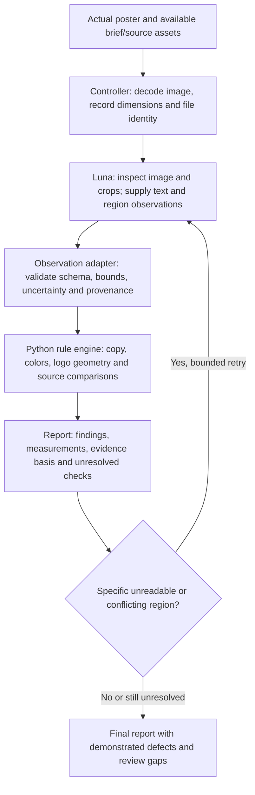

# Poster brand checker: model observations and deterministic rules

Design date: 2026-10-25 (Asia/Shanghai).

This document describes the existing checker and the requested model-fed
workflow. **The model-observation adapter below is a proposed interface, not an
implemented feature. GPT-5.6 Luna end-to-end execution has not been tested.**
The exact requested model was unavailable in this session. Its image-input and
tool capabilities must be established before running this workflow.

## 1. Purpose

Given a poster image, identify applicable Toastmasters brand requirements,
measure what the image and available sources support, and explain each result.
Luna supplies visual observations. Python applies the versioned brand rules,
performs pixel/geometry calculations, and preserves the evidence basis.

No separate OCR engine is required in the requested workflow. Text comes from
the image-capable model. Model reading can still make errors; deterministic rule
evaluation does not make the input observations infallible.

## 2. Responsibility boundary

| Work | Model | Script / controller |
|---|---|---|
| Read visible Chinese/English copy | Transcribe, locate and mark unreadable spans | Validate structure; compare supplied strings with rules |
| Identify logo, text, photo, illustration and QR regions | Propose regions and classifications | Validate bounds; crop actual pixels; measure geometry |
| Identify a tagline versus event topic | Supply classification and visual reason | Apply the correct string rule conditionally on that classification |
| Identify logo variant | Propose an official asset candidate | Compare against an independently obtained official reference |
| Determine colors | Identify design-fill regions versus photos | Sample actual pixels; compare permitted palette/gradient recipes |
| Determine exact font family | Report unknown unless source evidence exists | Verify supplied font file and glyph rendering when available |
| Decide organizational/event context | Extract visible clues; retain uncertainty | Use supplied context facts and apply eligibility rules |
| Calculate dimensions, hashes and output status | Do not guess tool results | Compute from actual files and actual execution |
| Establish inventory completeness | Inspect full image and crops; disclose uncertain areas | Check geometric coverage and omissions that can be detected; cannot prove semantic completeness |

The model must not fill in a favorable source palette, official-logo provenance,
font family or approval merely because it resembles an expected value.

## 3. Data flow



The controller handles file identity and tool execution; it can be an application
or the tool-enabled assistant environment. Python does not currently call a model
API. If Luna cannot inspect images, this workflow is unavailable for that model.
If Luna cannot run tools, a host application can execute Python on its behalf and
return the actual result.

## 4. Existing implementation

Paths below are relative to the repository root.

| File | Implemented responsibility |
|---|---|
| `skills/toastmasters-poster-reviewer/scripts/check_brand.py` | CLI, PNG/JPEG loading, candidate identity, v1/v2 routing, aggregate output |
| `skills/toastmasters-poster-reviewer/scripts/brand_rules.json` | Manual version, page references, palette, font roles, tagline and phrase rules |
| `skills/toastmasters-poster-reviewer/scripts/brand_extended.py` | V2 region/source/layout checks and context rules |
| `skills/toastmasters-poster-reviewer/scripts/logo_compare.py` | Compression-aware visual consistency comparison against a supplied reference |
| `skills/toastmasters-poster-reviewer/scripts/text_evidence.py` | Supplied font/glyph reproduction; optional local Tesseract fallback |
| `scripts/benchmark_poster_brand.py` | Run supplied specimens; score saved predictions against a separately frozen reference |

The v2 spec is `tm-poster-brand-check/v2`. It accepts `text_runs`, `logos`,
`layers`, `faces`, `color_regions`, `exclusions`, context and output-size facts.
Bounds are integer `[x, y, width, height]` in decoded-image coordinates.

Current execution from the repository root:

```sh
python3 skills/toastmasters-poster-reviewer/scripts/check_brand.py \
  --candidate poster.jpg --spec brand-check.json
```

The current `--evidence` option supplies renderer/source evidence and optional
OCR settings. It is not a model-observation interface. Supplying a model-read
string in `text_runs` alone currently does not corroborate that copy: the text
verifier attempts rendering/OCR and may return BLOCKED.

## 5. Proposed model-observation contract

Add an explicit model-observation input and adapter. Do not reinterpret the
existing renderer log as proof of a model observation, or fabricate a renderer
recipe for text that the model read.

Illustrative **proposed**, unimplemented payload:

```json
{
  "format": "tm-poster-observations/v1",
  "candidate_sha256": "<computed by controller>",
  "coordinate_space": "decoded-image-pixels",
  "producer": {
    "model_id": "<actual provider model ID>",
    "method": "model-image-observation"
  },
  "text_runs": [
    {
      "id": "text-1",
      "bounds": [40, 100, 500, 55],
      "text": "WHERE LEADERS ARE MADE",
      "readability": "clear",
      "role": "tagline",
      "role_reason": "Presented as a separate brand line",
      "font_family": null
    }
  ],
  "unresolved_regions": [],
  "inventory_claim": "partial"
}
```

This is a schema example, not an observation of one of the uploaded posters.
The controller records the actual model identity. The model supplies text,
bounds, roles, ambiguity and visual reasons. Unknown values remain null.
Ambiguous text includes alternatives or an unreadable span; it must not be
silently completed to an official phrase. Model confidence is not a calibrated
probability of correctness and cannot authorize a PASS by itself.

The adapter must:

1. Bind observations to the actual candidate identity and decoded dimensions.
2. Reject invalid/outside coordinates, malformed fields and duplicate IDs.
3. Keep full-image and crop coordinates consistent. Resized crop observations
   need a controller-recorded mapping back to original pixels.
4. Preserve model observations separately from source-backed facts and direct
   pixel measurements.
5. Treat missing inventory fields as unknown, not an empty successful check.
6. Keep rule outcomes tied to their inputs. A successful exact-string comparison
   is conditional on a correctly read and classified string.

## 6. What each check can establish

| Check | Required inputs | Result and limit |
|---|---|---|
| Tagline | Model-read text and tagline classification | Compare exact wording/case with permitted versions; mark basis as model observation |
| Marketing phrases | Relevant text runs and inventory coverage | Apply permitted phrases/count rules; partial inventory cannot establish a poster-wide count PASS |
| Digital logo minimum | Located logo bounds and intended output width | Measure scaled width against applicable minimum; report localization uncertainty |
| Print logo minimum | Logo bounds plus actual physical output width | Calculate inches; JPEG DPI alone does not establish intended print size |
| Logo proportions | Official reference and reliable logo bounds | Compare aspect ratio allowing disclosed raster rounding; uncertain localization is not proof of distortion |
| Logo consistency | Actual crop and trusted official reference | Compression-aware similarity; a mismatch alone is not proof of prohibited alteration |
| Clear space | Logo bounds, applicable source X measurement, nearby foreground regions | Measure boundary/foreground gaps; uncertain ink/boxes need review |
| Palette/gradients | Model-selected design regions and actual image | Measure actual pixels; JPEG drift/source-recipe uncertainty must be disclosed; photo colors are excluded by classification |
| Exact font family/effects | Actual font/source rendering evidence | Verify when supplied; model resemblance alone cannot prove family or absence of effects |
| Photograph/illustration relevance | Model classification and context | Retain as model judgment; Python cannot independently prove the semantic classification |

Bounding boxes from model inspection are estimates. Borderline spacing/size
decisions need refined localization or source geometry. A repeatable calculation
on an inaccurate box is still inaccurate.

File SHA-256 binds observations/results to one file version. It never compares
an embedded logo with an original or establishes visual correctness. Compression
changes the file identity, so a newly compressed export needs new observations
and measurements.

## 7. Result policy

Keep three evidence categories visible: `model observation`, `pixel measurement`
and `source verified`. A rule may be evaluated using a model observation, but
the result must not be described as independent machine confirmation of what
the model saw. Conditional findings still help the user act on a legible poster.

PASS means that a specific applicable rule is satisfied on the supplied evidence;
REVISE means a demonstrated defect; BLOCKED means required evidence is unresolved;
INFO means a metric, preference or requirement not numerically specified.

List demonstrated defects and unresolved checks independently. For example, a
clearly read altered tagline can produce a model-observed REVISE while font
identity remains BLOCKED. An empty/partial text inventory must not produce a
poster-wide marketing-phrase PASS. This is a required correction to the current
v2 empty-list count behavior.

Current v2 aggregates BLOCKED before REVISE at the scoped-verdict level and
REVISE before BLOCKED within each feature. The proposed adapter/report must
preserve known defects visibly; matching two overall BLOCKED results is not
successful validation. A full brand verdict remains separate from these checks.

## 8. Luna operating instructions

The production extraction prompt should give Luna the following bounded task:

> Inspect the actual poster and provided crops. Transcribe visible text and
> locate text, logos, photos, illustrations and QR regions in original-image
> coordinates. Record uncertainty and unknown font/source/context facts. Do not
> repair text, infer official provenance, invent measurements, classify every
> slogan as an official tagline, or apply brand-rule verdicts during extraction.
> Return the observation schema. After the controller runs the checker, report
> its exact findings with the evidence basis, defects and unresolved checks.

Use one full-image extraction followed by targeted crops where necessary. Bound
retries, preserve earlier observations and record corrections. Never keep
re-reading until a failing string happens to match an approved phrase. The model
must not alter rules, measurements or statuses while summarizing a report.

## 9. Validation needed for the requested goal

The target is **Luna image interpretation plus script**, compared with an
independent Sol review of the same actual poster and available source facts.
The old executor-only protocol in `tests/poster_executor_prompt.md` tests a
different task: running a checker on already prepared inventories.

For each fresh round, Tester supplies five positive and five negative specimens.
Withhold inventories generated from fixture source, generator labels and Sol
answers from Luna. Source assets genuinely available in the intended user flow
may be provided equally to both reviewers. Freeze Luna observations, code and
predictions before revealing Sol's judgments. Record extraction errors, missing
regions, incorrect roles, rule-engine errors and reporting changes separately.

Score per-feature agreement, case verdicts, demonstrated-defect detection,
false acceptance/rejection and abstention. Report completed coverage as well as
accuracy: an all-BLOCKED pipeline cannot meet the goal. Run JPEG compression,
Chinese text, wordmarks, absent logos, ambiguous text and missing-source cases.
Retesting development cases after a fix is regression evidence.

Previously reported 154/155 feature agreement and 59/60 scoped decisions came
from supplied-inventory Python runs against Sol references. They do not establish
Luna's extraction accuracy or end-to-end parity. Subsequent OCR changes also
changed the code revision; those earlier scores belong to their frozen revision.

## 10. Implementation status and remaining work

| Component | Status |
|---|---|
| Versioned rules, image measurements and source comparisons | Implemented, with documented limits |
| Optional Tesseract branch | Exists in current code; excluded from this requested model-fed design |
| Explicit model-observation schema/adapter | Proposed here; not implemented |
| Model-read copy results with retained evidence basis | Requires adapter/report change |
| OCR-free execution mode for this workflow | Requires implementation; omitting OCR settings does not disable current fallback |
| Partial/empty inventory phrase-count guard | Requires implementation |
| Luna extraction prompt and tool orchestration | Specified here; not validated with the requested model |
| GPT-5.6 Luna + script versus GPT-6.1 Sol | NOT RUN |

This document is a design handoff. No executable behavior was changed in the
documentation turn. The next implementation must add the observation adapter,
explicitly disable external OCR for this route, retain evidence distinctions,
and test the complete image-to-report path with the actual requested model.
